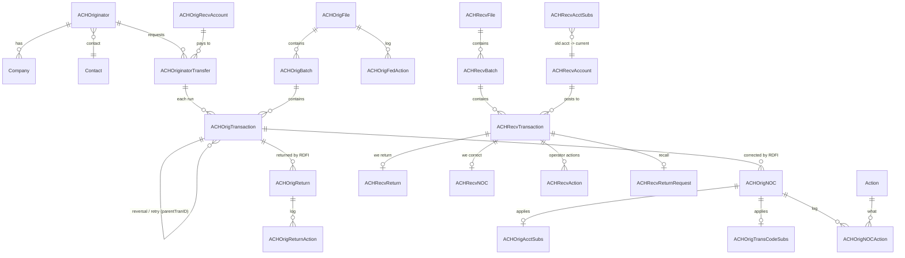

# Database Model: Review of Ba's Design and Plan

Source: Ba's [ACH Payments System Design](design/ACH-Payments-System-Design.docx) ("Database Model" section) and the [architecture diagram](design/architecture-diagram.png).

Ba's design replaces the first-pass model in [PLAN.md section 4](PLAN.md#4-database-design-first-pass). **Ba's table and column names are the standard from now on**, e.g. `ACHOrigTransaction`, `traceNo`, `lastModBy`. This file covers four things:
1. How Ba's tables map to the system's components.
2. What was tested.
3. What needs fixing or adding.
4. The questions Ba needs to answer before we write the real schema.

---

## 0. Decisions (2026-11-03): follow Ba's design

**Rule: Ba's design wins.** His table names, column names, types and keys stay exactly as he wrote them. We only **add** what's missing: columns, foreign keys, indexes and tables needed by a spec'd screen or a Nacha rule. Any fix in section 3 that would *change* something Ba defined is **dropped**, and its problem is handled in code instead.

### Answers to section 6

| # | Decision |
| --- | --- |
| Q1 | ✅ Yes. `ACHOrigReturn`/`ACHOrigNOC` = ones we **receive** on payments we sent. `ACHRecvReturn`/`ACHRecvNOC` = ones we **send back** on payments we received. |
| Q2 | ✅ Yes. `ACHRecvAccount` = our members' accounts. `ACHOrigRecvAccount` = outside accounts members pay. |
| Q3 | ✅ Yes. Each run of an `ACHOriginatorTransfer` creates one `ACHOrigTransaction` (same `transferSerNo`/`transferVersion`). Business payroll batches go straight to `ACHOrigBatch` + `ACHOrigTransaction`. |
| Q4 | ✅ A reversal or retry is a **new `ACHOrigTransaction` row**, with an added `parentTranID` column pointing to the original. Ba's action tables stay keyed as he wrote them. |
| Q5 | ✅ All fixes and tables that **add** something are approved. Fixes that **change** Ba's definitions are dropped (table below). |
| Q6 | ✅ Account numbers are plain text in the DB, with only the last 4 digits shown on screens. Encryption is revisited in roadmap step 16. |
| Q7 | ✅ **Separate databases, as in Ba's diagram.** They live on one MySQL server, so cross-database foreign keys and transactions still work. See the layout below. |
| Q8 | ✅ Keep `Process` as Ba wrote it. It holds a type label such as `ORIGINATION`, `RETURN` or `REVERSAL`; `processID`/`processName` identify the job run. |

### Database layout (Ba's diagram + his doc's sections)

| MySQL database | Tables |
| --- | --- |
| `ach_payments` (exists) | Ba's "Application Configuration and Logging": `AppParam`, `AppLog`. Shared and simulated pieces added later: `BankingCalendar`, `SimCoreAccount`, `ACHMemoPost`, `ACHEodPostingFile`, `OfacSdnName`, `ABADirectory`, `AppUser`/`AppRole`. |
| `ach_receiving` | Ba's "ACH Receiving" tables (`ACHRecv*`) + `ACHRecvAction`, `ACHRecvReturnRequest`, `ACHRecvAddenda` |
| `ach_origination` | Ba's "ACH Origination" and "Back Office" tables: `ACHOrig*`, `ACHOriginator`, `ACHOriginatorTransfer`, `Company`, `Contact`, `Source`, `ACHOperator`, `Action`, the action tables, + `ACHOrigAddenda` |

Flyway manages all three (`spring.flyway.schemas`), and `ach_app` gets privileges on each.

### Which section 3 fixes are kept

| Fix | Kept? | Note |
| --- | --- | --- |
| F1 `descriptiveDt` → text | ❌ Changes Ba's type | Keep `DATE`. Inbound values that aren't a date (e.g. `NOV 26`) are stored as `NULL`, which Ba's column allows, so the file still loads. |
| F2 `recvRtn` | ✅ Adds | |
| F3 `individualID`, `addendaInd` | ✅ Adds | Ba's `transactionDiscData` stays as he defined it |
| F4 `serviceClassCode` | ✅ Adds | |
| F5 foreign keys | ✅ Adds | |
| F6 cascade → restrict | ❌ Changes Ba's FK | Keep `ON DELETE CASCADE`. The app never deletes files. |
| F7 unique `traceNo` | ❌ Changes Ba's index | Keep Ba's index. The trace number generator guarantees uniqueness in code, with a test. |
| F8 rebuild `ACHRecvFile` | ❌ Changes Ba's columns | Keep Ba's columns. `fedStatus` holds `RECEIVED`/`VALIDATED`/`PROCESSED`/`REJECTED`, and parse errors go to `AppLog`. |
| F9 `immedDest`, `immedOrigin` | ✅ Adds | |
| F10 drop `originatorID`/`transferSerNo` on received entries | ❌ Changes Ba's columns | Keep them. `originatorID` is filled from the batch's Company ID, and `transferSerNo` is `NULL`. *Adding* `recvAcctSerNo`/`recvAcctVersion` is kept ✅. Status uses Ba's `fedStatus`. |
| F11 action-table key + reason | ❌ Changes Ba's PK | Keep Ba's key. `processID` tells repeated runs apart. |
| F12 `parentTranID` | ✅ Adds (Q4) | Ba's action tables are unchanged |
| F13 `ACHOrigReturnAction` | ✅ Follows Ba | DDL written from his field list, in the same shape as his other action tables |
| S1 extra limit-rule columns | ❌ Not needed | Ba's `ACHOrigLimitRule` is used as he wrote it (account type + days) |
| S2 `AppParam.effectiveDt` | ❌ Changes Ba's key | |
| S3, S4, S5 NOC/return deadline and status columns | ✅ Adds | Needed for Nacha deadlines (PLAN 5.7, 5.10) |
| S6 `contactID` on `ACHOriginator` | ✅ Adds | |
| S7 account number widths | ❌ Changes Ba's types | |
| S8 rename `thridPartyFlag` | ❌ Changes Ba's name | The spelling stays as Ba wrote it |
| S9 `Process` | ✅ Follows Ba (Q8) | |
| S10 `TransCodeSubs` key | ❌ Changes Ba's PK | |
| M1–M8 new tables | ✅ Adds | Placed per the layout above |

---

## 1. Ba's tables by component

Ba defines 31 tables. 30 come with `CREATE TABLE` SQL. `ACHOrigReturnAction` has a field list but no SQL.

| Component (spec / diagram) | Ba's tables |
| --- | --- |
| **Origination Engine & UI** | `ACHOrigTransaction`, `ACHOriginatorTransfer`, `ACHOrigRecvAccount`, `ACHOriginator`, `Company`, `Contact`, `ACHOrigLimitRule`, `ACHOrigFile`, `ACHOrigBatch`, `Source`, `ACHOperator` |
| **Origination Back Office** (Return, Reversal, Resubmission and NOC engines and UIs) | `Action`, `ACHOrigReturn`, `ACHOrigNOC`, `ACHOrigAcctSubs`, `ACHOrigTransCodeSubs`, `ACHOrigReturnAction`, `ACHOrigResubAction`, `ACHOrigNOCAction`, `ACHOrigReversalAction`, `ACHOrigFedAction` |
| **Receiving** (Ingestion, Processing, UI) | `ACHRecvFile`, `ACHRecvBatch`, `ACHRecvTransaction`, `ACHRecvAccount`, `ACHRecvReturn`, `ACHRecvNOC`, `ACHRecvAcctSubs`, `ACHRecvTransCodeSubs` |
| **Configuration & logging** | `AppParam`, `AppLog` |
| Memo Posting, EOD Posting, Screening/Fraud | *No tables yet* (see 4) |

**How we read Ba's design.** Each point below needs Ba to confirm it (see Q1–Q3):
- **NOCs:**
  - `ACHOrigNOC` holds NOCs we **receive** about entries we originated.
  - `ACHOrigAcctSubs` and `ACHOrigTransCodeSubs` apply those corrections to future entries.
  - `ACHRecvNOC` holds NOCs we **send** about entries we received.
  - `ACHRecvAcctSubs` maps an old account number to the current one, e.g. "post to the new account and send a C01". `ACHRecvTransCodeSubs` does the same for transaction codes, e.g. "post a 22 to savings as a 32 and send a C05".

  This matches the NOC split already in the plan (PLAN.md 5.10), and its DB model handles both directions.
- **Returns:**
  - `ACHOrigReturn` holds returns we **receive** on our originated entries.
  - `ACHRecvReturn` holds returns we **send** on received entries.
- **Transfers and accounts:**
  - `ACHOriginatorTransfer` is a member's transfer request, which can be recurring. Each run of it creates an `ACHOrigTransaction` row linked by `transferSerNo` and `transferVersion`.
  - `ACHOrigRecvAccount` holds external accounts our members send to.
  - `ACHRecvAccount` holds our members' own accounts that receive entries.
- **Action tables:**
  - `*Action` tables are the workflow log: which process did which `Action` (HOLD, RELEASE, …) to an item, and when.
  - `AppLog` is the technical error log.

---

## 2. What was tested

All 30 `CREATE TABLE` statements and all 13 sample `INSERT`s from the doc were run on a scratch MySQL database, which was then dropped.

| Check | Result |
| --- | --- |
| Ba's 30 `CREATE TABLE` statements | ✅ All run with no errors |
| Ba's 13 sample `INSERT` statements | ✅ All run with no errors |
| Foreign keys actually created | ⚠️ Only 3: `ACHOrigBatch→ACHOrigFile`, `ACHRecvBatch→ACHRecvFile`, `Company→ACHOriginator` |
| Inbound batch whose Company Descriptive Date is `NOV 26` (free text, as real files allow) | ❌ Rejected: `Incorrect date value: 'NOV 26' for column 'descriptiveDt'`. A real inbound file would fail to load. |
| Two originated entries with the same trace number | ❌ Accepted. Return and NOC matching by trace number would then be ambiguous. |
| Return for a `tranID` that doesn't exist | ❌ Accepted. Nothing stops orphan records. |
| The same action twice on one NOC in one process, e.g. HOLD → RELEASE → HOLD | ❌ Rejected by the primary key, so a repeated action can't be logged |

The doc contains hidden icon characters pasted from a chat window. They sit in front of some SQL statements. Clean them out before copying the SQL anywhere.

---

## 3. Fixes to Ba's tables

### Must fix (would break real processing)

| # | Table(s) | Problem | Proposed fix |
| --- | --- | --- | --- |
| F1 | `*Batch`, `*Transaction` | `descriptiveDt DATE`: the Nacha Company Descriptive Date is free text (e.g. `NOV 26`, or blank), so loading inbound files fails (tested). | `VARCHAR(6)` |
| F2 | `ACHOrigTransaction` | **No receiving bank routing number.** We can't build the Entry Detail record without it. | Add `recvRtn CHAR(9)`, which includes the check digit |
| F3 | `*Transaction` | Missing the Individual ID number (positions 40–54, e.g. employee ID). `transactionDiscData VARCHAR(2)` mixes two different fields: discretionary data (positions 77–78) and the addenda indicator (position 79). | Add `individualID VARCHAR(15)`. Keep `transactionDiscData VARCHAR(2)` and add `addendaInd CHAR(1)`. |
| F4 | `*Batch` | Missing the Service Class Code (200 mixed, 220 credits, 225 debits), which is a required batch header field | Add `serviceClassCode CHAR(3)` |
| F5 | All | Only 3 foreign keys; orphans are accepted (tested) | Add FKs: Transaction → Batch → File; Return/NOC → Transaction; Transfer → `ACHOrigRecvAccount` and `ACHOriginator`; `*Action.actionID` → `Action`; `sourceID` → `Source` |
| F6 | `ACHOrigBatch`, `ACHRecvBatch` | `ON DELETE CASCADE`: deleting a file silently deletes its batch history. Nacha requires keeping entry records for 6 years. | `ON DELETE RESTRICT` |
| F7 | `ACHOrigTransaction` | `traceNo` isn't unique (tested) | Make it a `UNIQUE` index. For received entries, uniqueness is only guaranteed per sending bank, so make `(fileID, traceNo)` unique there. |
| F8 | `ACHRecvFile` | Copied from `ACHOrigFile`, so it has `sendTm`/`acknowledgedTm` and a status for files we *send*. An inbound file needs a received time, a validation status and error details. | Replace with `receivedTm`, `fileStatus` (`RECEIVED → VALIDATED → PROCESSED` / `REJECTED`) and `errorMesg` |
| F9 | `*File` | Missing the Immediate Destination and Immediate Origin (who the file is from and to) | Add `immedDest CHAR(10)` and `immedOrigin CHAR(10)` |
| F10 | `ACHRecvTransaction` | `originatorID NOT NULL` and `transferSerNo` come from origination. Received entries don't have them, so we'd have to make up values. It also isn't linked to the member account it posts to and has no receiving status. | Drop those two columns. Add `recvAcctSerNo`/`recvAcctVersion` (FK) and `recvStatus` (`RECEIVED → SCREENED → MEMO_POSTED → POSTED`, or `INTERCEPTED → RETURNED`). |
| F11 | `*Action` tables | The primary key `(item, processID, actionID)` blocks repeating an action (tested). There's no reason or comment column, but auditors need the reason. | Add `actionLogID BIGINT AUTO_INCREMENT` as the primary key and add `actionReason VARCHAR(255)` |
| F12 | `ACHOrigReversalAction`, `ACHOrigResubAction` | Keyed by `fileID` only, so we can't tell **which entry** was reversed or resubmitted. The spec allows single-item reversals. | Add `parentTranID` to `ACHOrigTransaction`, so a reversal or retry entry points to the original. Key the action tables by `tranID`. (Q4) |
| F13 | `ACHOrigReturnAction` | No SQL. Its field list mixes in `fileID` and `nocID` from the other action tables. | Same shape as the others, keyed by `returnID` |

### Should fix (correctness and clarity)

| # | Table(s) | Problem | Proposed fix |
| --- | --- | --- | --- |
| S1 | `ACHOrigLimitRule` | No credit/debit column, even though rule names like `DAILY_CHECKING_DEBIT_CAP` imply one. No per-originator limits, so every business member gets the same cap. No Same Day per-entry limit. | Add `creditFlag`, `originatorID` (NULL means all) and `sameDayFlag` |
| S2 | `AppParam` | **Deferred** (USE-CASES.md P5: the Parameter UI keys on `systemName`+`paramName` only). No effective date, but the Same Day limit is already scheduled to change from $1M to $10M on 2027-09-17 | Add `effectiveDt` to the primary key |
| S3 | `ACHRecvNOC` (sent) | No workflow fields | Add `nocStatus` (`DRAFT → APPROVED → SENT`), `approvedBy`, and `dueDt` (2 banking days after settlement) |
| S4 | `ACHOrigNOC` (received) | Can't track the Nacha deadlines | Add `notifyByDt` (2 banking days), `applyByDt` (6 banking days), `appliedTm`, and `refusedCode` (C61–C69) |
| S5 | `ACHRecvReturn` (sent) | No deadline and no WSUD tracking | Add `dueDt` (2 banking days, or 60 days for R05/R07/R10/R11) and `wsudFlag` |
| S6 | `Contact` | Not linked to anything | Add `contactID` to `ACHOriginator` |
| S7 | Account columns | `VARCHAR(17)` in transactions but `VARCHAR(34)` in account and substitution tables. Domestic ACH allows at most 17. | Use `VARCHAR(17)` everywhere. Encryption (Q6) may change this. |
| S8 | `ACHOrigRecvAccount`, `*AcctSubs` | `thridPartyFlag` is misspelled | Rename it to `thirdPartyFlag` now, before any code uses it |
| S9 | `ACHOrigBatch`, `ACHRecvBatch` | `Process`, `processID` and `processName` overlap, and `Process` is capitalized unlike the rest | Ask Ba what `Process` holds |
| S10 | `*TransCodeSubs` | The primary key `(nocID, nocAcctNo, nocRtn)` is unique on `nocID` alone. Lookups will be by account, routing number and company. | Primary key `nocID`, plus an index on `(nocAcctNo, nocRtn, companyID)` |

**Accepted from Ba:**
- **`DECIMAL(13,2)` for money.** It's exact like integer cents, so PLAN.md assumption A7 is updated to match.
- **The PascalCase/camelCase naming.**
- **Separate `Orig`/`Recv` tables.**

---

## 4. Tables the spec needs that aren't in Ba's model yet

| # | Needed by | Proposed table |
| --- | --- | --- |
| M1 | Receiving UI (accept, correct, intercept, recall) | `ACHRecvAction`, the same shape as the other action tables |
| M2 | Receiving recall (Request for Return from the sending bank, 10-banking-day response) | `ACHRecvReturnRequest`: tranID, requesting bank, reason, received date, due date, decision (`R06`/`R31`/`DECLINED`) |
| M3 | Parsing (`05` payment-info addenda; return and NOC addenda details) | `ACHRecvAddenda` / `ACHOrigAddenda`: tranID, type code, content |
| M4 | Memo Posting Eligibility Engine | `ACHMemoPost`: tranID, account, amount, hold or post, status, time. The account **balances** live in the simulated core, so a sim-only `SimCoreAccount` table is needed. |
| M5 | EOD Batch Posting Generator (and making sure reruns don't double post) | `ACHEodPostingFile` (file, cycle date, totals, status), plus `postingStatus` and `eodFileID` on each transaction table |
| M6 | Settlement dates and every Nacha deadline | `BankingCalendar`: Fed holidays |
| M7 | Screening/fraud (OFAC, AML, limits) | `ofacStatus` is only on `ACHOriginatorTransfer`, so add `screenStatus` to both transaction tables. Fraud alert tables come later (PLAN.md section 6). |
| M8 | Login, roles, dual control | `AppUser`, `AppRole`, planned for hardening (roadmap step 16) |

Same Day windows and cutoffs fit in `AppParam`, which Ba's sample already does with `FED_FILE_CUTOFF_TIME`, so they don't need a table.

---

## 5. Relationships (after the fixes)

---

## 6. Questions for Ba (✅ all answered: see section 0)

1. **Q1:** Is `ACHOrigNOC` for NOCs we receive and `ACHRecvNOC` for NOCs we send (and the same for returns)?
2. **Q2:** Is `ACHRecvAccount` our members' own accounts, and `ACHOrigRecvAccount` the external accounts they pay?
3. **Q3:** Does each run of an `ACHOriginatorTransfer` create one `ACHOrigTransaction` with the same `transferSerNo`/`transferVersion`? Do business payroll batches skip `ACHOriginatorTransfer` and go straight to `ACHOrigBatch` and `ACHOrigTransaction`?
4. **Q4:** Should reversals and resubmissions be new `ACHOrigTransaction` rows pointing to the original (`parentTranID`, F12), or new `transferVersion`s of the same transfer?
5. **Q5:** Are the fixes in section 3 and the added tables in section 4 OK?
6. **Q6:** Should account numbers be encrypted in the database? Nacha requires it for large originators and ODFIs, and it would change those columns to `VARBINARY`. Or is plain text plus masking in the UI enough for a demo?
7. **Q7:** One MySQL schema with `ACHOrig*`/`ACHRecv*` tables (current plan, A4), or two separate databases as drawn in the diagram?
8. **Q8:** What does `Process` mean in the batch tables (S9)?

---

## 7. Plan

1. Write Ba's tables, plus the agreed fixes, as Flyway migrations in `src/main/resources/db/migration/`. Split them by component. `V1__app_param_and_log.sql` (config and logging, in `ach_payments`) ships first, with the Parameter UI ([USE-CASES.md](USE-CASES.md)). After that: `V2__receiving.sql` (`ach_receiving`), `V3__origination.sql` and `V4__back_office.sql` (`ach_origination`). Only the fixes kept in section 0 are applied.
   - Verify: the app starts against an empty `ach_payments` and Flyway applies all of them.
2. Turn the tests in section 2 into automated integration tests.
   - Verify: a file with a free-text descriptive date loads (stored as `NULL`); orphan returns and orphan transactions are rejected by FKs; the trace number generator never repeats.
3. Load Ba's 13 sample rows as demo seed data. Fix them where the new constraints require it; for example:
   - the sample transfer points to receiving account `REC-883721`, which doesn't exist;
   - the sample routing number `051000031` fails the ABA check digit (weighted sum 58, not a multiple of 10).
   - Verify: they insert cleanly.
4. Continue the roadmap at step 4 (inbound ingestion), which writes parsed files into `ACHRecvFile`, `ACHRecvBatch` and `ACHRecvTransaction`.
