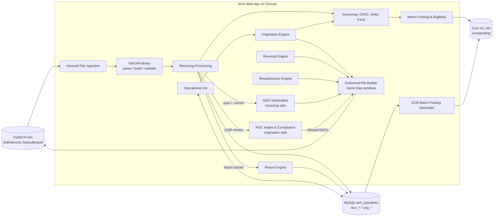

# ACH Payments System: Implementation Plan

This plan is based on the architecture description and component diagram from Ba. It covers the Same Day ACH payments system and leaves a place for the Fraud Monitoring & Prevention system to plug in.

---

## 1. Assumptions

| # | Assumption | Status |
| --- | --- | --- |
| A1 | **A demo system for a bank or credit union**, modeled on a large credit union like Navy Federal. It acts as both the **ODFI** (sends ACH for members) and the **RDFI** (receives ACH into members' accounts). | ✅ Confirmed |
| A2 | **FedACH and the Core GL are simulated.** A real FedACH connection needs FedLine, a bank charter and certificates. We use drop folders (`fed/inbound`, `fed/outbound`, `core/posting`) plus small simulator tools. | ✅ Confirmed |
| A3 | **One app, not microservices.** All "engines" are modules inside one Java web app (a WAR on Tomcat). | It's much simpler for two people. Modules can be split out later if needed. |
| A4 | **One MySQL database (`ach_payments`)** holds two groups of tables: `recv_*` (Receiving DB) and `orig_*` (Origination DB). | The diagram shows two DBs. Logical separation is enough for now and avoids cross-database transactions. |
| A5 | **The backend is Java 21, Spring Boot 4 (REST API, WAR on Tomcat 11), MySQL, Flyway for schema migrations and Maven. The frontend is React + TypeScript (Vite).** The React build is bundled into the WAR, so there's still one deployable. | ✅ React confirmed |
| A8 | **Users:** internal credit-union staff log in to the operations app. Members and business members originate through the **digital banking channel**, which calls our Origination REST API. A demo "Business Member Portal" stands in for that channel (see 7). | ✅ Decided |
| A9 | **The Fraud system is a module in the same app** (`screening/`). | ✅ Confirmed |
| A6 | **"Cryptographic signatures" on inbound files** are simulated as a detached SHA-256 HMAC (or PGP) signature file next to each NACHA file. | Real FedLine security works at the transport layer. A signature check still exercises the validation step. |
| A7 | **Money is stored as integer cents (`BIGINT`)**, never floating point. | Rounding errors in payments are unacceptable. |

---

## 2. Architecture overview



### Code layout (Java packages)

```
com.achpayments
├── nacha/          # Pure Java: record models, parser, writer, validators (no Spring, no DB)
├── common/         # Money, banking-day calendar, audit log, settings, security
├── receiving/      # Ingestion engine, processing component, Receiving UI
│   └── noc/        # NOC Generation: create outbound NOCs from the exceptions queue (5.10 A)
├── origination/    # Origination engine, limit rules (ACHOrigLimitRule), Origination UI
│   └── noc/        # NOC Intake & Compliance: received NOCs, 2/6-day tracking, refused NOCs (5.10 B)
├── returns/        # Return processing engine + UI
├── reversal/       # Reversal engine + UI
├── resubmission/   # Resubmission engine + UI
├── outbound/       # Builds outbound NACHA files, Same Day window scheduler
├── posting/        # Memo posting eligibility, EOD batch posting file generator
├── screening/      # OFAC, limit checks, fraud rules (the Fraud system plugs in here)
└── sim/            # FedACH simulator, Core GL simulator, test file generator

frontend/           # React + TypeScript (Vite). Ops UIs + demo member portal. Built into the WAR.
```

---

## 3. NACHA file format (the foundation)

Every engine depends on this, so it's built first and tested heavily.

- The file is fixed-width text: **94 characters per record**, blocked in groups of 10 records and padded with lines of all `9`s.
- Record types:

| Type | Record | Key fields |
| --- | --- | --- |
| `1` | File Header | Immediate destination/origin, file creation date/time, File ID modifier |
| `5` | Batch Header | Service class (200/220/225), Company Name, Company Discretionary Data, Company ID, **SEC code**, **Company Entry Description**, Company Descriptive Date, Effective Entry Date, Settlement Date (Julian, set by the Fed), ODFI ID, Batch Number |
| `6` | Entry Detail | **Transaction code**, RDFI routing + check digit, account number, amount, Individual ID, Individual Name, Discretionary Data, addenda indicator, **Trace Number** |
| `7` | Addenda | `05` = payment info, `98` = NOC, `99` = return |
| `8` | Batch Control | Entry/addenda count, **entry hash**, total debits, total credits, Company ID |
| `9` | File Control | Batch count, block count, entry/addenda count, entry hash, totals |

- Validation rules:
  - Every line is exactly 94 characters.
  - Routing numbers pass the check-digit test (weights 3-7-1).
  - **Entry hash** = sum of the first 8 digits of each RDFI routing number, keeping only the last 10 digits.
  - Batch and file control counts and totals match the entries.
  - Batch numbers are ascending.
  - The block count is correct.
  - Transaction codes are valid for the SEC code.
- Transaction codes:

| Code | Meaning |
| --- | --- |
| `22` / `27` | Checking credit / debit |
| `32` / `37` | Savings credit / debit |
| `23` / `28` / `33` / `38` | Prenotes (zero-dollar test entries) |
| `21` / `26` / `31` / `36` | Returns and NOCs |

- SEC codes in scope: `PPD`, `CCD`, `WEB`, `TEL`, `COR` (NOC). Add `CTX` and `IAT` later. **IAT can't be sent Same Day.**
- Required Company Entry Descriptions: `PAYROLL`, `PURCHASE`, `REVERSAL`, `RETRY PYMT`.

**Done when:** we can parse a sample file and write it back out byte-for-byte identical (round trip), and every validation rule has a passing and a failing test.

---

## 4. Database design (first pass)

All tables get `id`, `created_at`, `updated_at` and `version` (optimistic locking). Account numbers are **encrypted at rest** and **masked in the UI** (last 4 digits only), as the Nacha data-security rules require.

### Shared

| Table | Purpose |
| --- | --- |
| `app_user`, `app_role` | Operators, Approvers, Compliance, Admin |
| `audit_log` | Who did what, when, before/after values and reason. Every UI action writes one row. |
| `banking_calendar` | Fed holidays, used to work out banking days, settlement dates and deadlines |
| `ach_setting` | Key, value and **effective date**, e.g. Same Day limit $1M, then $10M from 2027-09-17 |
| `same_day_window` | Fed submission deadline and settlement time per window (10:30/13:00, 14:45/17:00, 16:45/18:00 ET) |
| `dda_account` | **Simulated** bank customer accounts: number, name, status, ledger balance, available balance, holds |

### Receiving (`recv_*`)

| Table | Key columns |
| --- | --- |
| `recv_file` | File name, immediate origin/destination, creation date/time, File ID modifier, signature valid, totals, status (`RECEIVED → VALIDATED → PROCESSED` / `REJECTED`), error details |
| `recv_batch` | `file_id`, batch number, service class, company name/ID/description, SEC code, effective entry date, settlement date, ODFI ID, totals |
| `recv_entry` | `batch_id`, **trace number**, transaction code, RDFI routing, account number (encrypted), amount in cents, individual ID/name, discretionary data, matched `dda_account_id`, **status**, screening result |
| `recv_addenda` | `entry_id`, addenda type, payment-related info |
| `recv_action` | Operator actions: accept, correct, intercept, recall. Includes reason and approver. |
| `recv_outbound_return` | Returns **we** send back as the RDFI (from intercepts, recalls or automatic returns such as R03 when no account is found): return code, original trace, deadline, WSUD reference, status (`PENDING → QUEUED → SENT`, or `DISHONORED` / `CONTESTED`) |
| `recv_outbound_noc` | NOC **we** send: `entry_id`, change code, corrected data, created by, **approved by**, deadline (2 banking days after settlement), status (`DRAFT → APPROVED → QUEUED → SENT`, or `REFUSED`), refusal code, merger-campaign ID |
| `recv_return_request` | Incoming **Request for Return** ("recall") from the sending bank: entry, requesting ODFI, reason, received date, **10-banking-day response deadline**, decision (`RETURNED_R06` / `RETURNED_R31` / `DECLINED`), date the ODFI was notified |

**Receiving entry status:** `RECEIVED → SCREENED → (MEMO_POSTED | PENDING_REVIEW) → ACCEPTED → POSTED`. An entry can branch to `INTERCEPTED → RETURNED` or `CORRECTED`.

### Origination (`orig_*`)

| Table | Key columns |
| --- | --- |
| `orig_originator` | Corporate client: company name, **Company ID**, settlement account, allowed SEC codes, Same Day allowed, status |
| `orig_limit_rule` | **ACHOrigLimitRule**: originator, scope (`PER_ENTRY`, `PER_BATCH`, `DAILY`, `SAME_DAY_DAILY`), direction (credit/debit), SEC code (optional), limit in cents, active dates |
| `orig_batch` | Originator, SEC code, company entry description, effective date, same-day flag, status, totals, created by, approved by |
| `orig_entry` | `batch_id`, transaction code, receiver routing + account (encrypted), amount, individual ID/name, trace number (assigned at send), **status**, screening result, `parent_entry_id` (for reversals and resubmissions) |
| `orig_outbound_file` | File name, window, sent at, totals, Fed acknowledgment status |
| `orig_return` | `entry_id` (matched by trace number), return code, return date, addenda info, fee charged, matched/unmatched |
| `orig_noc` | Received NOC: `entry_id`, change code (C01–C14), corrected data, received/settlement date, **originator-notified-by** (2 banking days), **must-apply-by** (6 banking days or before the next entry, whichever is later), applied at, refused (C61–C69) flag |
| `orig_reversal` | Original entry or batch, reason (duplicate, wrong receiver, wrong amount, wrong date), requested by/approved by, deadline |
| `orig_resubmission` | Original entry, attempt number (max 2), reason, scheduled date |

**Origination entry status:** `DRAFT → PENDING_APPROVAL → APPROVED → SCREENED → QUEUED → SENT → SETTLED`. An entry can branch to `REJECTED`, `RETURNED`, `REVERSED` or `RESUBMITTED`.

---

## 5. Detailed workflows

### 5.1 Inbound file ingestion (component A)

1. A file lands in `fed/inbound/` (the FedACH sim puts it there). A poller picks it up every N seconds.
2. **Idempotency:** compute a SHA-256 hash of the file. Skip it if we've seen it before, matching on hash or on File ID modifier + creation date/time.
3. Verify the signature file → `signature_valid`.
4. Parse with the `nacha/` library and run the full structural validation: headers, control records, batch totals and entry hash.
5. If the file is invalid, mark it `REJECTED`, store the errors, alert operations and **stop**. No entries are saved.
6. If it's valid, save the file, batches, entries and addenda **in one DB transaction**, then mark it `VALIDATED`.
7. Move the raw file to `fed/archive/` and keep it, since the original is needed for audits.

### 5.2 Receiving processing (component A)

For each entry in a validated file:

1. **Route by type.**
   - Return entries (addenda `99`) go to the **Return Engine** (5.6).
   - COR/NOC entries (addenda `98`) go to **NOC Intake** (5.10 B). Refused NOCs about NOCs *we* sent go to **NOC Generation** (5.10 A).
   - Everything else goes through normal receiving.
2. **Match the account.** Look up `dda_account` by account number. If nothing matches, auto-return the entry: **R03** (no account) or **R04** (invalid number). If the account is closed or frozen, return **R02** or **R16**.
3. **Screen.** Run OFAC on the individual name and company name, then the fraud rules (section 6). A hit sets `PENDING_REVIEW`.
4. **Check the date.** Entries with a future effective date wait. Same Day entries (settlement date = today) are processed now.
5. Hand clean entries to **Memo Posting** (5.4).

### 5.3 Receiving UI

- **Search and filter** on batch number, trace number, tranCode, SEC code, Company ID/Name/Description, settlement date, effective entry date, discretionary data, amount (range), receiving account, account name and originator ID.
- Paged results with a detail view showing the entry, its batch, its file, its addenda and its full action history.
- **Actions.** Every action needs a reason and is audited. High-risk actions need a second user to approve (dual control).
  - **Accept:** release a `PENDING_REVIEW` item to posting.
  - **Correct:** fix a mis-routed entry so it points to the right internal account, e.g. a typo'd account number with a matching name. The entry is posted to the corrected account, and the operator can choose **"post + send NOC"** (5.10 A).
  - **Intercept:** stop the item before it posts and return it with a chosen return code. This creates an **outbound return** (5.7 B), and the UI only offers codes that are still within their deadline.
  - **Recall:** "Recall" isn't an official Nacha term. It's the industry name for an **ODFI Request for Return**: the sending bank asks us to send back an entry we received, e.g. a duplicate, a wrong amount or suspected fraud. The rules since Oct 2024 / Apr 2025 work like this:
    - The ODFI may request a return **for any reason**, and the ODFI indemnifies us if we comply.
    - **Complying is optional**, but we **must tell the ODFI our decision or the status within 10 banking days** of receiving the request. The UI shows a countdown.
    - If we agree, we return the entry with **R06** ("Returned per ODFI's Request"). For CCD/CTX corporate entries past the normal deadline, the ODFI must agree and we use **R31**.
    - If it has already posted, we check whether pulling the funds would overdraw the member's account. For a credit, we normally need the member's permission or proof of fraud.
    - Each request is tracked in `recv_return_request`.

### 5.4 Memo posting and eligibility (component C)

1. Look up the account's available balance, holds and status.
2. **Credits:** usually eligible. A memo credit raises the available balance, unless a fraud hold applies.
3. **Debits:** eligible if the available balance covers the debit and the account allows debits, i.e. it's not a savings account over its withdrawal limit and has no debit block. Otherwise it's an **NSF**. Depending on bank policy, the entry either returns **R01** or goes to review.
4. Write the memo post, a pending transaction against the available balance, and send an "Immediate Memo Post" to the Core GL sim. Mark the entry `MEMO_POSTED`.
5. The **Core GL sim** keeps `dda_account` balances so we can watch it work end to end.

### 5.5 Origination (component B)

1. **Create.** In the Origination UI, an operator picks an originator, enters a batch (SEC code, entry description, effective date, the **Same Day** checkbox) and adds entries. Uploading a CSV or NACHA file is a later feature.
2. **Validate on entry.**
   - Routing check digit passes.
   - Transaction code is valid.
   - The originator is allowed to use this SEC code.
   - The entry description follows the PAYROLL/PURCHASE rules.
   - Same Day entries are **≤ the Same Day limit** for the effective date ($1M now, $10M from 2027-09-17) and are not IAT.
3. **Approve.** A different user approves the batch (dual control).
4. **Screen.**
   - **ACHOrigLimitRule** checks per-entry, per-batch, daily and Same Day daily limits.
   - **OFAC** checks the receiver names.
   - **Fraud rules** run (section 6). WEB debits need a fraud-detection pass and account validation (a prenote, or a previous successful payment).
   - On a fail, the entry is held for review or rejected.
5. **Queue.** Approved and screened batches become `QUEUED` for the next window. Same Day batches go to the next Same Day window. If they miss the last window (4:45 PM ET), the effective date rolls to the next banking day, with a warning in the UI.
6. **Settle.** The originator's settlement account gets the offsetting entry: credits debit the originator, and debits credit them on settlement.

### 5.6 Outbound file builder and Same Day windows

1. A scheduler runs before each Fed window: Same Day deadlines are 10:30, 14:45 and 16:45 ET, plus the next-day windows.
2. It collects everything that's `QUEUED`: originated batches, reversals, resubmissions, **outbound returns** (5.7 B) and **outbound NOCs and refused NOCs** (5.10). Returns and NOCs are grouped into their own batches. It then assigns **trace numbers** (ODFI routing + a 7-digit sequence), computes the control records and writes the NACHA file.
3. It re-parses its own output with the validator before sending. A bad file must never leave the system.
4. It drops the file in `fed/outbound/`, marks the entries `SENT` and records the file in `orig_outbound_file`.
5. The **FedACH sim** acknowledges the file and, for testing, can generate returns and NOCs against it.

### 5.7 Return processing (both directions)

One **Return Engine** handles both directions of returns:
- **A. Inbound returns:** returns *of* entries we originated (the "ACH Origination Return Processing Engine" in the diagram).
- **B. Outbound returns:** returns *we* send as the receiving bank. These are missing from the diagram (G5).

#### A. Inbound returns (we're the ODFI)

1. Return entries arrive in inbound files (routed from 5.2). The addenda `99` record carries the return code, the original trace number and the original RDFI.
2. **Match** each return to an `orig_entry` by original trace number. If there's no match, it goes to an "unmatched returns" queue in the Return UI.
3. Update the original entry to `RETURNED`, store the code, reverse the originator's settlement and charge a **return fee** (configurable per originator).
4. **Code-specific behavior:**

| Codes | Action |
| --- | --- |
| R01, R09 (NSF / uncollected) | Eligible for **resubmission** (5.9) |
| R02, R03, R04 | Flag the receiver account as bad and block future entries to it |
| R05, R07, R10, R11, R29 (unauthorized) | Count toward the originator's **unauthorized return rate**. Nacha's threshold is 0.5%. Alert compliance. |

5. Track the overall return rate (threshold 15%) and administrative returns (threshold 3%) per originator.
6. The **Return UI** lists returns with filters, the match status and a manual match action.
7. **Dishonored returns:** if a return comes back late or with wrong data, we can dishonor it within 5 banking days (R61, R67–R70). Later phase.

#### B. Outbound returns (we're the RDFI)

1. **Where they come from:**
   - **Automatic** during receiving (5.2):

| Code | Reason |
| --- | --- |
| R01 | NSF |
| R02 | Account closed |
| R03 | No account |
| R04 | Invalid account number |
| R16 | Frozen account |
| R20 | Non-transaction account |

   - **Manual** from the Receiving UI: **Intercept**, or **Recall** (R06/R31).
   - **Fraud**: **R17** with the descriptor `QUESTIONABLE` in the addenda.
2. **Deadlines**, enforced by `BankingCalendar`:

| Window | Codes |
| --- | --- |
| **2 banking days** (the return must reach the ODFI by the opening of business on the 2nd banking day after settlement) | Most codes, including R01–R04, R16, R17, R20 |
| **60 calendar days** after settlement, and only with a **Written Statement of Unauthorized Debit (WSUD)** from the member | Unauthorized consumer debits: R05, R07, R10, R11, R37 |
| **No fixed Nacha return deadline** (governed by the request rules above) | R06 and R31 |

3. **Build the return entry:**
   - Same SEC code as the original.
   - Return transaction code: `21`/`26` for checking, `31`/`36` for savings.
   - Same amount.
   - Addenda `99` with the return code, the **original trace number**, the original RDFI and any extra info.
4. **Reverse the member's memo/ledger post** (debit back a credit, or credit back a debit) and queue the return for the next window, Same Day included (5.6).
5. **Contested dishonors:** if the ODFI dishonors our return, we can contest it (R71–R77). Later phase.

### 5.8 Reversal processing (component B)

1. A corporate originator asks to reverse an erroneous or duplicate entry or file. An operator enters the request in the **Reversal UI**.
2. **Validate:**
   - The reason is one of the allowed ones: duplicate, wrong receiver, wrong amount or wrong date.
   - The request is **within 5 banking days of settlement**.
   - The original entry was `SENT` or `SETTLED`.
3. Create a reversing entry with the **opposite transaction code**, the **same amount and receiver** and Company Entry Description **`REVERSAL`**, linked by `parent_entry_id`. A whole-file reversal creates one reversing batch per original batch.
4. Approve with dual control, then send it through normal screening and outbound.
5. A reversal can itself be returned. Handle that like a normal return.

### 5.9 Resubmission (component B)

1. **Eligible:** returns R01/R09 (allowed **at most 2 times**, within **180 days** of the original settlement date), or a return whose cause has been fixed, e.g. new authorization obtained after an R07.
2. **Automatic mode:** a rule per originator, e.g. "retry R01 after 3 banking days".
3. **Manual mode:** an operator schedules it in the **Resubmission UI**.
4. The new entry uses the same amount and receiver, Company Entry Description **`RETRY PYMT`** and `parent_entry_id` = the original. The attempt number is incremented and enforced.
5. It goes through normal screening and outbound.

### 5.10 NOC (Notification of Change)

A NOC is a **zero-dollar correction message**: "this payment reached the right person, but the details were out of date, so use these next time." It's a COR entry with an addenda `98` record carrying a change code and the corrected data.

**This design changes the spec.** The spec puts one "NOC Generation & Fed Transmission Engine" under Origination. Research on how banks and ACH systems actually do it (FLEX credit union core, Jack Henry jXchange, the Fed's FedLine "Derive a Return or NOC" tool, Increase/Modern Treasury/Column APIs, Treasury Green Book ch. 6) shows that every public system *creates* NOCs on the **receiving** side, in the exceptions queue next to returns, and *handles received NOCs* on the **origination** side. The two jobs have different owners, deadlines and liability, so the plan splits them into the two parts below. Both share the Outbound File Builder (5.6), which keeps the spec's "Fed transmission" idea.

| Code | Correction | Allowed on federal payments? |
| --- | --- | --- |
| C01 | Account number | ✅ |
| C02 | Routing number | ✅ |
| C03 | Routing + account | ✅ |
| C04 | Individual or company name | ❌ |
| C05 | Transaction code (checking ↔ savings) | ✅ |
| C06 | Account + transaction code | ✅ |
| C07 | Routing + account + transaction code | ✅ |
| C09 | Individual ID number | ❌ |
| C13 | Addenda format error | ❌ |
| C14 | Incorrect SEC code for outbound IAT | ❌ |

#### A. NOC Generation (receiving side, `receiving/noc/`)

We're the RDFI. A payment came in with outdated details, but we could tell which member it was for.

1. **Trigger:** on an exception item, the Receiving UI offers three choices: **Post**, **Return** (5.7 B), or **Post + send NOC**. Typical cases:
   - an old account number from before a conversion (C01);
   - checking vs savings mixed up (C05);
   - a misrouted entry we could still match (C02/C03).
2. **Build the draft:** the operator picks the change code and enters the corrected data. The UI pre-fills it from the account the entry was posted to.
3. **Approve:** a Supervisor must approve the draft, because the bank **warrants the corrected data is accurate** and is liable if it's wrong.
4. **Deadline:** a NOC must go out **within 2 banking days of the original entry's settlement date**. The UI shows a countdown, and the system blocks NOCs after the deadline. NOCs caused by a merger are exempt.
5. **Federal payments profile:** if the original came from a federal agency (e.g. DFAS military pay, SSA, VA), only C01, C02, C03, C05, C06 and C07 are allowed. The Individual ID (claim number) is copied **exactly** from the original. This matters for a credit union like Navy Federal, which receives a lot of federal payments.
6. **Send:** the NOC is queued as a COR batch with addenda `98` and goes out in the next window via the Outbound File Builder.
7. **Refusals:** if the sending bank refuses our NOC (C61–C69), it comes back here. We can send a corrected NOC within **5 banking days**.
8. **Merger bulk mode** (later phase): a list of old → new account numbers creates C01/C03 NOCs for every matching incoming entry, still with approval.

The data lives in `recv_outbound_noc`.

#### B. NOC Intake & Compliance (origination side, `origination/noc/`)

We're the ODFI. A NOC came back about a payment one of our business members sent.

1. **Match:** match the COR entry to the original `orig_entry` by trace number and store it in `orig_noc`.
2. **Validate:** check the NOC against the original entry. If it's defective, e.g. the wrong trace number, badly formatted corrected data, or a routing or account number that isn't from the original, offer a **Refused NOC** (C61–C69). The refusal must go out **within 15 days** and goes through the Outbound File Builder. Refusals are rare, so this is a small screen, not a big workflow.
3. **Notify the business member within 2 banking days** of the NOC's settlement date, by an alert in the Business Member Portal (17) plus a NOC report. The deadline is tracked in `orig_noc`.
4. **Track the correction window:** for recurring payments, the business member must apply the change **within 6 banking days or before the next entry, whichever is later**. For one-time payments, the member may decide whether to act (rule effective June 21, 2024).
5. **Apply the correction:** the member applies it, or staff do with dual approval, and saved receiver details are updated so future entries use the new data.
6. **Enforce it:**
   - **Flag** any new entry to a corrected receiver that still uses the old data, and hold it if the window has passed. Nacha fines **the ODFI** (us) when originators ignore NOCs. It's one of the most common violations, with published fines of $1,000–$20,000.
   - **Report** NOC compliance per originator.

The **NOC UI** has two tabs: "NOCs we sent" (A) and "NOCs we received" (B). Each shows status, deadlines and whether the correction has been applied.

### 5.11 EOD batch posting (component C)

1. At EOD cutoff (configurable), the generator takes every entry for the business date:
   - receiving entries that are `ACCEPTED` or `MEMO_POSTED`
   - origination settlement entries
   - returns, reversals and fees
2. It builds the **Batch Posting File**: one line per account posting with account, amount, debit/credit, an effective date and a reference back to the trace number. The format is a fixed-width or CSV spec that we define.
3. It's **idempotent per business date**. It never posts twice. Each run has a control total and a hash.
4. It drops the file in `core/posting/`. The Core GL sim applies it: memo posts become final ledger posts and holds are released.
5. **Reconciliation report:** memo posts vs. final posts vs. Fed settlement totals. Anything that doesn't match shows up as an exception.

---

## 6. Fraud Monitoring & Prevention (hook now, build later)

The system is a `screening/` module with one interface: `ScreeningResult screen(Entry, Context)`. The result is `ALLOW`, `REVIEW` or `BLOCK`, plus a score and reasons. It's called from origination (5.5 step 4) and receiving (5.2 step 3).

Starter rules, as the 2026 Nacha risk-based monitoring rules require for both originators and receivers:

| Rule | Example |
| --- | --- |
| Velocity | More than N entries or $X to the same account in 24 hours |
| New payee + large amount | First payment to this account is over a threshold |
| Amount anomaly | More than 3× the originator's typical entry |
| Same Day + new payee | A high-risk combination |
| Name mismatch | The receiving entry's name differs from the account holder's name (catches credit-push fraud and mule accounts) |
| WEB debit account validation | No prior successful prenote or payment means `REVIEW` |
| Bad-account list | Accounts previously returned R02, R03 or R04 |
| OFAC | Sample SDN list loaded locally |

There's also a review queue in the UI where compliance can release or reject items. Receiving-side outcomes:
- **Release** the item.
- **Hold the funds:** Nacha lets an RDFI delay funds availability on credits it suspects were sent under **false pretenses**, but only when fraud detection flags the entry. It can't delay just because the credit hasn't been screened yet, and we must notify the ODFI.
- **Return as R17** with `QUESTIONABLE`.

---

## 7. Cross-cutting concerns

- **Users and access**, set up the way a large credit union like Navy Federal would:

| Who | How they get in | What they can do |
| --- | --- | --- |
| **ACH Operator** (staff) | Staff login (demo: local accounts; later SSO via OIDC) | Search, review and enter items |
| **ACH Supervisor / Approver** (staff) | Staff login | Second approval for originations, reversals, intercepts and recalls |
| **Fraud / BSA Analyst** (staff) | Staff login | Review queue, holds, R17 returns, OFAC hits |
| **Admin** (staff) | Staff login | Users, limit rules, settings, calendars |
| **Business Member** | Through digital banking, which calls our **Origination REST API**. In the demo, a simple React "Business Member Portal" with its own login. | Create and submit their own batches (payroll, vendor payments), limited by `orig_limit_rule` |
| **Retail Member** | Through digital banking only (e.g. "external transfer") | Single entries through the API, with tighter limits |

  Members never see the operations screens.
- **Security:** Spring Security with the roles above, dual control on approvals and risky actions, CSRF/CORS protection on the API, and no secrets in git.
- **Branding:** this is a demo. We don't use Navy Federal's name or logo in the UI unless they approve it.
- **Audit:** every state change and UI action goes to `audit_log`.
- **Data protection:** account numbers are encrypted in the DB (AES-GCM, key kept outside the repo) and masked in the UI and logs.
- **Banking-day math:** one `BankingCalendar` service handles all deadlines (returns, reversals, NOCs, resubmissions). Fed holidays are loaded per year.
- **Time zone:** all Fed deadlines are **America/New_York**. Timestamps are stored in UTC.
- **Observability:** structured logs and a simple ops dashboard showing today's files, window status, exceptions and return rates.

---

## 8. Testing strategy

| Layer | What | How |
| --- | --- | --- |
| NACHA library | Parse/write round trip, every validation rule | JUnit with golden sample files under `src/test/resources/nacha/` |
| Business rules | Limits, deadlines, return-code handling, Same Day cutoffs | Unit tests with a fixed clock and calendar |
| DB + engines | Ingestion → processing → memo post → EOD | Integration tests against a local `ach_payments_test` DB |
| End to end | The sim generates a file, the system processes it, and the posting file is checked | Scripted scenario: "100 entries, 3 NSF, 1 R03, 1 NOC" |
| UI | Key screens load, filters work, actions are audited | Spring MockMvc, plus a manual checklist |

---

## 9. Roadmap (small assignments)

Each step is small enough for one assignment and has a clear "done" check.

| # | Assignment | Done when |
| --- | --- | --- |
| 0 | **Skeleton:** Maven + Spring Boot WAR, Flyway, React (Vite + TS) frontend built into the WAR, deploy to Tomcat, `/api/health` checks the DB | `http://localhost:8080/ach/` shows the React page, and it displays "DB OK" from the API |
| 1 | **NACHA model + parser** (record types 1/5/6/7/8/9) | Sample file parses, and tests pass |
| 2 | **NACHA writer + validator** | Round trip is byte-identical, and every validation rule has tests |
| 3 | **FedACH sim: test file generator** | A CLI generates valid inbound files with N random entries |
| 4 | **Inbound ingestion + Receiving DB** (5.1) | Dropped file → rows in `recv_*`, bad file → `REJECTED` with errors |
| 5 | **Receiving UI: search + detail** (5.3, read-only) | All filters from the spec work |
| 6 | **Simulated DDA accounts + memo posting** (5.4) | Balances update, and NSF debits are flagged |
| 7 | **Receiving actions:** accept, intercept → outbound return, correct, recall/Request for Return (5.3, 5.7 B) | Actions audited, deadlines enforced, return file valid |
| 8 | **EOD posting file + Core GL sim** (5.11) | Posting file balances to control totals, and reruns don't double post |
| 9 | **Originators + ACHOrigLimitRule + Origination UI** (5.5) | Create → approve → queue, and limits enforced |
| 10 | **Outbound builder + Same Day windows** (5.6) | Files go out per window, and a missed cutoff rolls to the next day |
| 11 | **Return processing** (5.7) | Sim returns are matched, fees charged, rates calculated |
| 12 | **NOC Generation + NOC Intake** (5.10 A and B) | Post + NOC creates a valid COR file and enforces approval, the 2-day deadline and federal codes. A received C01 notifies the originator, starts the 6-day window and flags a repeat entry with the old account number. |
| 13 | **Reversals** (5.8) | 5-banking-day rule enforced, REVERSAL batch sent |
| 14 | **Resubmissions** (5.9) | Max 2 retries within 180 days enforced |
| 15 | **OFAC + fraud rules v1 + review queue** (section 6) | The rules in the table fire on test data |
| 16 | **Hardening:** login/roles, dual control, encryption, ops dashboard | Security checklist passes |
| 17 | **Demo Business Member Portal** (React) using the Origination API | A business member submits a payroll batch, and it shows up for staff approval |

Steps 0–3 don't depend on any open questions, so we can start immediately.

---

## 10. Questions for Ba

**Answered:**
- Q1: it's a demo bank system (A1).
- Q2: simulated, per the plan (A2).
- Q3: NOCs are split into Generation (receiving) and Intake & Compliance (origination), based on research into how banks do it (5.10).
- Q4: Recall = Request for Return with R06/R31 (5.3).
- Q5: one Return Engine handles both directions (5.7).
- Q6: React.
- Q7: same app.
- Q8: staff plus members through digital banking (section 7).

**Still open:** none.

### Gaps found in the diagram (both the spec and the diagram have these)

- **G1:** The Origination Engine only persists to the Origination DB. **No component sends originated payments, resubmissions or reversals to the Fed.** The plan adds an Outbound File Builder (5.6).
- **G2:** The spec lists a "Reversal Processing Engine", but the diagram has only the Reversal UI, which writes straight to the Origination DB. The plan adds a Reversal engine (5.8).
- **G3:** Returns and NOCs arrive in inbound Fed files, but the Inbound engine only writes to the Receiving DB. **Nothing routes them to the Return or NOC engines.** The plan routes them in 5.2.
- **G4:** The lifecycle summary says AML, OFAC and ACHOrigLimitRule checks are applied, but **no screening component** appears in the diagram. The plan adds `screening/` (section 6).
- **G5:** The Receiving UI can intercept and recall, which means sending returns to the Fed, but the diagram has **no path from receiving to the Fed**. The plan handles these in the Return Engine (5.7 B) and sends them through the Outbound File Builder (5.6).
- **G6:** The spec puts NOC generation under Origination. Real systems create NOCs on the receiving side and handle received NOCs on the origination side. The plan splits the engine (5.10).
